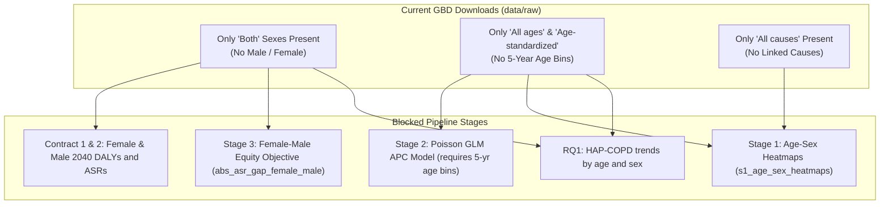

# AEGIS-GBD Data Validation Report

**Date:** 2026-11-16  
**Auditor:** Data Validation Engineer (Person A / AEGIS-GBD)  
**Scope:** Evaluation of raw downloaded datasets in `data/raw/` against specifications in `docs/DATA_SPEC.md`, `AGENTS.md`, and project research questions.

---

## Executive Summary

| Metric | Count | Details |
|---|---|---|
| **Total Datasets Identified** | 8 | 3 GBD 2023 zips, 1 WHO GHO CSV, 2 UN WPP CSVs, 3 World Bank JSONs, 1 GBD 2021 codebook |
| **Pass** | 0 | None without warnings or critical gaps |
| **Pass with Warnings** | 4 | WHO Clean Cooking (`data (1).csv`), UN WPP 2024 (1950–2023 & 2024–2100), World Bank JSONs |
| **Fail (Critical Gaps)** | 3 | All 3 GBD 2023 export zips (missing Sex and Age disaggregations) + Missing `manifest.json` |
| **Not Tested / Unmatched** | 1 | GBD 2021 Air Pollution Codebook (auxiliary reference only) |
| **Overall Verdict** | **BLOCKED** | **Downloaded datasets are NOT collectively sufficient to proceed.** GBD downloads lack male/female and 5-year age groups required for core research questions, Stage 1 heatmaps, Stage 2 APC models, and Stage 3 sex-equity optimization. |

---

## Dataset-by-Dataset Validation Matrix

| # | Dataset / Filename | Intended Role (`DATA_SPEC.md`) | Checks Performed | Status | Key Findings & Blocker Analysis | Recommended Action |
|---|---|---|---|---|---|---|
| **1** | `IHME-GBD_2023_DATA-010d0c57-1.zip` *(CSV: 1.29 MB, 5,440 rows)* | `gbd2023_hap_copd_southasia.csv` (Primary historical burden outcome, Stages 1–2) | File integrity, columns, 5 countries, 1990–2023, uncertainty invariants, duplicate keys | **FAIL** | - **Critical:** ONLY `Both` sexes present (`sex_id=3`). `Male` and `Female` are completely missing. - **Critical:** ONLY `All ages` and `Age-standardized` present. Standard 5-year age groups (15-19 ... 95+) are missing. - 0 nulls, 0 duplicate rows, invariants $0 \le \text{lower} \le \text{val} \le \text{upper}$ hold 100%. | **Re-download from IHME GBD Results Tool** selecting `Sex`: `Both`, `Male`, `Female` AND `Age`: `All ages`, `Age-standardized`, plus 5-year age groups. |
| **2** | `IHME-GBD_2023_DATA-7546b8be-1.zip` *(CSV: 410 KB, 2,176 rows)* | `gbd2023_total_copd_southasia.csv` (Denominator for attributable share, Stage 1) | File integrity, columns, 5 countries, 1990–2023, uncertainty invariants, duplicate keys | **FAIL** | - **Critical:** ONLY `Both` sexes present. `Male` and `Female` are missing. - Age groups present: `All ages` and `Age-standardized` (sufficient for national denominator, but lacks sex split). - 0 nulls, 0 duplicates, valid invariants. | **Re-download** selecting `Sex`: `Both`, `Male`, `Female`. |
| **3** | `IHME-GBD_2023_DATA-89044603-1.zip` *(CSV: 374 KB, 1,836 rows)* | `gbd2023_hap_all_causes_ind_npl.csv` (COPD share of total HAP burden, Stage 1) | File integrity, columns, 5 countries, 1990–2023, uncertainty invariants, duplicate keys | **FAIL** | - **Critical:** ONLY `All causes` (`cause_id=294`) present. Level 3 linked causes (LRI, IHD, Stroke, Lung cancer, Cataract) are missing. - **Critical:** ONLY `Both` sexes present. - **Critical:** ONLY `All ages` present (`Age-standardized` is missing). | **Re-download** selecting `Cause`: `All causes` + linked causes, `Sex`: `Both`, `Male`, `Female`, `Age`: `All ages`, `Age-standardized`. |
| **4** | `data (1).csv` *(71.7 MB, 195,840 rows)* | `who_sdg712_clean_cooking.csv` (WHO SDG 7.1.2 clean fuel access & fuel shares) | Readability, indicator codes, ISO3 match, years (1990–2023), residence types, fuel categories, bounds | **PASS WITH WARNINGS** | - **Contents:** 100% complete for all 5 countries, all 34 years (1990–2023), all 3 residence types (Total, Urban, Rural), and all 6 fuel types (Biomass, Gas, Electricity, Coal, Charcoal, Kerosene). - Proportions within valid bounds $[0, 99.0]\%$. 0 nulls in project rows. 0 duplicates. - **Warning:** Generic browser filename `data (1).csv`. Contains global data (71.7 MB). | Sufficient for pipeline. Copy/rename or point ingestion to this file; filter to South Asia during Stage 0. |
| **5** | `WPP2024_PopulationBySingleAgeSex_Medium_1950-2023.csv` *(Directory + CSV: 418 MB)* | `un_wpp2024_pop_by_age_sex.csv` (Historical pop offsets 1990–2023) | Readability (chunked), ISO3 match, years, single ages (0..100+), sex consistency, nulls, duplicates | **PASS WITH WARNINGS** | - **Contents:** 100% complete for all 5 countries, all years (1950–2023, including required 1990–2023), all 101 single-year ages. - Zero nulls in population fields. Internal sum invariant $|\text{PopMale} + \text{PopFemale} - \text{PopTotal}| \le 0.001\text{k}$ holds. - **Warning:** Single-year age (101 bins) instead of 5-year groups (21 bins); nested folder `.csv/.csv`. | Sufficient for pipeline. Ingestion script will aggregate single-year ages to standard 5-year groups. |
| **6** | `WPP2024_PopulationBySingleAgeSex_Medium_2024-2100.csv` *(Directory + CSV: 441 MB)* | `un_wpp2024_pop_by_age_sex.csv` (Projections 2024–2040) | Readability (chunked), ISO3 match, years, single ages (0..100+), sex consistency, nulls, duplicates | **PASS WITH WARNINGS** | - **Contents:** 100% complete for all 5 countries, all projection years (2024–2100, including required 2024–2040), all 101 single ages. - Zero nulls. Invariants hold. - **Warning:** Single-year age; nested folder `.csv/.csv`. | Sufficient for pipeline. Combine with historical file and filter to 1990–2040 during Stage 0. |
| **7** | `EG.CFT.ACCS*.json` (3 files) *(~130–138 KB each, 528 rows)* | World Bank SDG 7.1.2 access (% total, rural, urban) | JSON parser, country codes, date range, nulls | **PASS WITH WARNINGS** | - Contains total, rural, and urban % for all 5 countries from 2000–2024. - Data is rounded integers; pre-2000 dates are null. - Redundant given the presence of richer WHO data in `data (1).csv`. | Retain as secondary cross-check; do not use as primary driver. |
| **8** | `IHME_GBD_2021_AIR_POLLUTION_1990_2021_CODEBOOK_Y2024M06D06.csv` *(22.5 KB, 771 rows)* | Unmatched / GBD 2021 auxiliary metadata | CSV parser, column inspect | **NOT TESTED** | - GBD 2021 metadata/codebook, not GBD 2023. Contains no empirical burden data. | Ignore / archive. Not required by active pipeline. |
| **9** | `data/raw/manifest.json` | Provenance registry (`AGENTS.md` §5, `DATA_SPEC.md` §1) | Existence check | **FAIL** | - Missing mandatory raw file manifest with SHA-256 and download metadata. | Generate `manifest.json` once correct GBD files are in place. |

---

## Detailed Gap Impact on Downstream Stages

1. **Female vs. Male Equity Metric (`abs_asr_gap_female_male`):**
   `configs/default.yaml` line 91 sets the Stage 3 GA optimization objective to minimize the sex disparity:
   $$\text{Equity Gap} = \sum_u w_u \left|\text{ASR}^F_u - \text{ASR}^M_u\right|$$
   Because the GBD export only contains `Both` sexes combined, empirical female and male baseline rates and historical trajectories do not exist.
2. **Age-Period-Cohort (APC) Model:**
   `METHODOLOGY.md` §Stage 2.1 requires fitting a Poisson GLM APC baseline model with age, period, and cohort spline terms. APC models mathematically require discrete multi-age cohorts (standard 5-year GBD age bins). The current file has only 2 rows per year per country (`All ages` and `Age-standardized`).
3. **Stage 1 Age-Sex Heatmaps:**
   Deliverable `outputs/figures/s1_age_sex_heatmaps.png` cannot be generated.

---

## What Must Be Fixed in the IHME GBD Export

To unblock the project, re-download the 3 GBD queries from the [IHME GBD Results Tool](https://vizhub.healthdata.org/gbd-results/) using these exact settings:

### Query 1: HAP-Attributable COPD (`gbd2023_hap_copd_southasia.csv`)
- **GBD Estimate:** `Risk factor`
- **Risk:** `Household air pollution from solid fuels`
- **Cause:** `Chronic obstructive pulmonary disease`
- **Measures:** `Deaths`, `DALYs (Disability-Adjusted Life Years)`
- **Metrics:** `Number`, `Rate`, `Percent`
- **Locations:** `India`, `Nepal`, `Pakistan`, `Bangladesh`, `Bhutan`
- **Age:** Select **`All ages`**, **`Age-standardized`**, AND **all 5-year age groups** (e.g. `15-19`, `20-24` ... through `95 plus`)
- **Sex:** Select **`Both`**, **`Male`**, **`Female`** *(CRITICAL: do not select only Both)*
- **Year:** `1990` to `2023` (all annual years)

### Query 2: Total COPD Denominator (`gbd2023_total_copd_southasia.csv`)
- Same as Query 1, but under **GBD Estimate:** `Cause of death or injury` (Cause: `Chronic obstructive pulmonary disease`), with **`Both`**, **`Male`**, **`Female`**.

### Query 3: HAP All Linked Causes (`gbd2023_hap_all_causes_ind_npl.csv`)
- **GBD Estimate:** `Risk factor`
- **Risk:** `Household air pollution from solid fuels`
- **Causes:** `All causes` PLUS Level 3 linked causes (`Chronic obstructive pulmonary disease`, `Lower respiratory infections`, `Ischemic heart disease`, `Stroke`, `Tracheal, bronchus, and lung cancer`, `Diabetes mellitus`, `Cataract`)
- **Locations:** `India`, `Nepal`
- **Sex:** `Both`, `Male`, `Female`
- **Age:** `All ages`, `Age-standardized`
