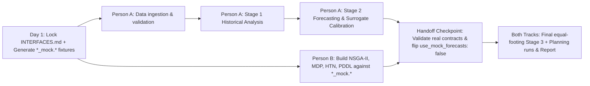

# Track Interfaces & Data Contracts

Person A (Rudraksh — Data & Forecasting) and Person B (Aanya — Optimisation & Planning) work in parallel from **Day 1**. This document locks the file paths, schemas, units, and mock-to-real hand-off rules so Track B never blocks on Stage 1–2 completion.

> **Change Rule:** Neither track may rename columns, change units, or alter file paths listed below without updating this document and notifying the other owner first.

---

## 1. Dependency Timeline



| Phase | Rudraksh (Person A) Deliverable | Aanya (Person B) Deliverable | Interface State |
| --- | --- | --- | --- |
| **Hour 1 / M0** | Pair on `*_mock.*` schema & build `src/data/contracts.py` validator | Build `*_mock.*` fixtures tailored to evaluator (`B-00`), then start `B-01` | `interfaces.use_mock_forecasts: true` |
| **Stage 1–2 Dev** | Real `data/interim/` + Stage 1 + Stage 2 CV & forecasts | Develop & unit-test NSGA-II, MDP, HTN, STRIPS/PDDL using mocks | Mock contracts validated by tests |
| **Handoff** | Write real `forecasts_stage3.csv`, `baseline_unit_state.csv`, `exposure_response_surrogate.json` | Run contract validation + switch `use_mock_forecasts: false` | Schema parity verified |
| **Final Runs** | Final Stage 1–2 figures + Stage 2 re-evaluation of top Pareto points | Final Stage 3 Pareto front, MDP vs GA table, PDDL/HTN traces | Real data locked |

---

## 2. Contract 1: Stage 3 & MDP Forecast Table
- **Production file:** `data/processed/forecasts_stage3.csv` (+ `.meta.json`)
- **Day-1 Mock file:** `data/processed/forecasts_stage3_mock.csv` (+ `.meta.json`)
- **Granularity:** One row per `location × year × sex × scenario × measure × metric`.
  - `location` (4 units): `IND_urban`, `IND_rural`, `NPL_urban`, `NPL_rural`
  - `year`: annual `2025–2040` (at minimum `2025, 2030, 2035, 2040` plus `2026–2040`; recommended all annual years `2025–2040` = 16 years)
  - `sex`: `female`, `male`, `both`
  - `scenario`: `bau` (business-as-usual clean-fuel trajectory) + reference counterfactual anchors (`cf_25`, `cf_50`, `cf_75`, `cf_100` representing clean-fuel share targets, used to cross-check the surrogate)
  - `measure`: `DALYs`, `Deaths`
  - `metric`: `Number`, `Rate_per_100k` (Age-standardised rate for `Rate_per_100k`)

### Schema
| Column | Dtype | Units / Allowed Values | Notes |
| --- | --- | --- | --- |
| `location` | `str` | `IND_urban`, `IND_rural`, `NPL_urban`, `NPL_rural` | Exact decision unit ID |
| `year` | `int` | `2025` .. `2040` | Calendar year |
| `sex` | `str` | `female`, `male`, `both` | Required for equity objective |
| `scenario` | `str` | `bau`, `cf_25`, `cf_50`, `cf_75`, `cf_100` | Driver trajectory |
| `measure` | `str` | `DALYs`, `Deaths` | Burden measure |
| `metric` | `str` | `Number`, `Rate_per_100k` | `Rate_per_100k` = ASR |
| `val` | `float` | `>= 0.0` | Point / mean forecast |
| `lower` | `float` | `>= 0.0, <= val` | 95% UI lower bound |
| `upper` | `float` | `>= val` | 95% UI upper bound |
| `population` | `float` | Persons (`> 0`) | Apportioned UN WPP 2024 pop |
| `clean_fuel_share` | `float` | `[0.0, 1.0]` | Assumed/projected clean-fuel coverage |
| `model_name` | `str` | e.g., `hist_gbdt_panel`, `poisson_apc`, `mock_generator` | Best validated Stage 2 model |
| `is_mock` | `bool` | `true` or `false` | Must be `false` for final results |
| `data_version` | `str` | e.g., `GBD_2023_WPP_2024` or `MOCK_V1` | Provenance tag |

### Example Rows *(Synthetic Schema Illustration Only — Do Not Use as Data)*
```csv
location,year,sex,scenario,measure,metric,val,lower,upper,population,clean_fuel_share,model_name,is_mock,data_version
IND_rural,2030,female,bau,DALYs,Rate_per_100k,0.0,0.0,0.0,1.0,0.50,mock_generator,true,MOCK_V1
NPL_rural,2040,both,bau,DALYs,Number,0.0,0.0,0.0,1.0,0.40,mock_generator,true,MOCK_V1
```
*(Zeroed placeholder values above illustrate column types only. Day-1 mock generator fills deterministic synthetic baselines clearly flagged `is_mock=true`.)*

---

## 3. Contract 2: Baseline Unit State (`t_0 = 2025`)
- **Production file:** `data/processed/baseline_unit_state.csv`
- **Day-1 Mock file:** `data/processed/baseline_unit_state_mock.csv`
- **Granularity:** One row per `location` (`IND_urban`, `IND_rural`, `NPL_urban`, `NPL_rural`).

| Column | Dtype | Units / Allowed Values | Notes |
| --- | --- | --- | --- |
| `location` | `str` | `IND_urban`, `IND_rural`, `NPL_urban`, `NPL_rural` | Primary key |
| `country` | `str` | `India`, `Nepal` | Parent country |
| `residence` | `str` | `urban`, `rural` | Residence stratum |
| `baseline_year` | `int` | `2025` (or latest observed + short-term step) | Pre-intervention anchor |
| `population_total` | `float` | Persons | Apportioned WPP 2024 population |
| `population_female_share` | `float` | `(0.0, 1.0)` | Female share |
| `clean_fuel_share_init` | `float` | `[0.0, 1.0]` | Starting clean-cooking access (SDG 7.1.2) |
| `lpg_infra_ready_init` | `bool` | `true` / `false` | Starting LPG supply readiness |
| `grid_ready_init` | `bool` | `true` / `false` | Starting electric cooking grid readiness |
| `bau_dalys_2040_female` | `float` | DALYs (`>= 0`) | Baseline 2040 projected DALYs (female) |
| `bau_dalys_2040_male` | `float` | DALYs (`>= 0`) | Baseline 2040 projected DALYs (male) |
| `bau_asr_2040_female` | `float` | Rate per 100k (`>= 0`) | Baseline 2040 projected ASR (female) |
| `bau_asr_2040_male` | `float` | Rate per 100k (`>= 0`) | Baseline 2040 projected ASR (male) |
| `is_mock` | `bool` | `true` / `false` | Flag |
| `data_version` | `str` | Version string | Provenance |

---

## 4. Contract 3: Fast Exposure–Response Surrogate
- **Production file:** `data/processed/exposure_response_surrogate.json`
- **Day-1 Mock file:** `data/processed/exposure_response_surrogate_mock.json`
- **Purpose:** Lets NSGA-II and MDP compute DALYs averted in microseconds on CPU instead of re-running ML/APC inside every fitness evaluation.
- **Required JSON Keys:**
```json
{
  "schema_version": "1.0",
  "is_mock": true,
  "data_version": "MOCK_V1",
  "functional_form": "log_linear_or_piecewise_paf",
  "generated_at": "YYYY-MM-DDTHH:MM:SSZ",
  "source_model": "stage2_best_model_or_placeholder",
  "units": {
    "IND_urban": {"slope_clean_fuel": null, "baseline_clean_fuel": null, "sex_elasticity_ratio_f_to_m": null, "uncertainty_sd": null},
    "IND_rural": {"slope_clean_fuel": null, "baseline_clean_fuel": null, "sex_elasticity_ratio_f_to_m": null, "uncertainty_sd": null},
    "NPL_urban": {"slope_clean_fuel": null, "baseline_clean_fuel": null, "sex_elasticity_ratio_f_to_m": null, "uncertainty_sd": null},
    "NPL_rural": {"slope_clean_fuel": null, "baseline_clean_fuel": null, "sex_elasticity_ratio_f_to_m": null, "uncertainty_sd": null}
  }
}
```
*(In `*_mock.json`, Aanya populates clearly labelled placeholder numerical parameters derived from `docs/ASSUMPTIONS.md`—paired with Rudraksh's schema validator—so evaluator math executes cleanly before Stage 2 finishes.)*

---

## 5. Temporary Mock Strategy Rules
1. `configs/default.yaml` controls `interfaces.use_mock_forecasts`. When `true`, Stage 3 and Planning automatically read `*_mock.*` files and stamp all outputs with `WARNING_MOCK_INPUTS: true` so mock runs can never be confused with final results.
2. Day-1 mock files are deterministic (seeded via `seeds.global`), lightweight (<50 KB), and committed under the explicit `!data/processed/*_mock.*` `.gitignore` exception.
3. At the Handoff Checkpoint, Person A runs `src/forecast/export_contracts.py` to generate real contracts and verifies schema parity using the shared contract test suite (`tests/`).
