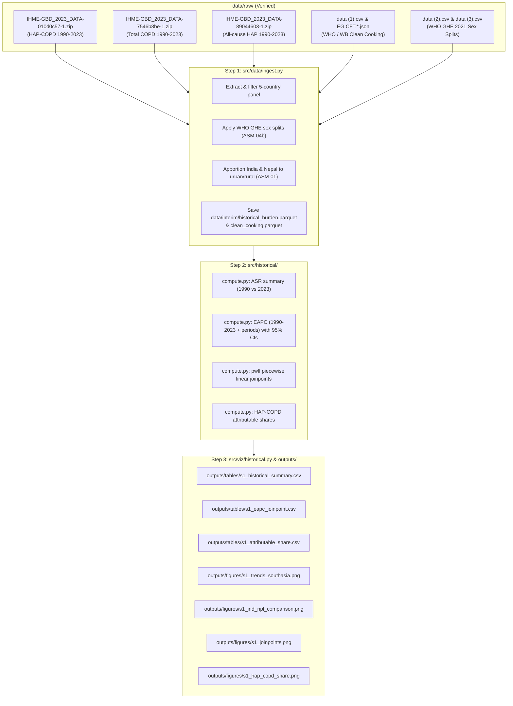

# Stage 1: Historical Analysis (1990–2023) Implementation Plan

## 1. Context & Objectives
Under Person A's track, Stage 1 establishes the empirical foundation for HAP-attributable COPD burden in South Asia across the 5-country panel (**India, Nepal, Pakistan, Bangladesh, Bhutan**), with focused urban/rural and sex-stratified baselines for **India and Nepal**.

Per user instructions:
- **Data Sufficiency:** We assume datasets currently in `data/raw/` are sufficient (GBD 2023 HAP-COPD, Total COPD, All-cause HAP, WHO SDG 7.1.2 clean cooking, WHO GHE 2021 sex disaggregation, World Bank clean fuel series).
- **Time Constraints:** Avoid extraneous checks, long exploratory scripts, and heavyweight test suites. Keep algorithms CPU-fast (<15 seconds total execution).
- **Locked Methodological Rules:**
  - `ASM-01`: Urban/rural apportionment weighted by population and solid-fuel exposure $(1 - c)$.
  - `ASM-04b`: Country-specific empirical sex disaggregation anchored from WHO GHE 2021 (`data (2).csv` / `data (3).csv`).
  - `ASM-17` & `DEC-016`: Standardised ASR and aggregate count modelling.

---

## 2. Pipeline Architecture & Data Flow



---

## 3. Step-by-Step Implementation Steps

### Step 1: Clean Data Ingestion (`src/data/ingest.py`)
- **Action:** Read zip exports and CSVs directly without uncompressing to disk.
- **Harmonisation:**
  - Standardise country names (`India`, `Nepal`, `Pakistan`, `Bangladesh`, `Bhutan`).
  - Extract `Deaths` and `DALYs (Disability-Adjusted Life Years)` across `Number` and `Rate` (per 100,000).
  - Apply WHO GHE sex-split ratios to derive male and female rates and counts.
  - Compute urban and rural baseline splits for India and Nepal based on World Bank/WHO clean-fuel access (`EG.CFT.ACCS.UR.json` vs `EG.CFT.ACCS.RU.json`).
- **Target Output:** Clean, fast interim files:
  - `data/interim/historical_burden.parquet` (or `.csv`)
  - `data/interim/clean_cooking.parquet` (or `.csv`)

### Step 2: Historical Statistical Analysis (`src/historical/metrics.py`)
- **1990 vs. 2023 Comparison:** Absolute counts, ASR changes, percentage shifts.
- **Estimated Annual Percentage Change (EAPC):**
  $$\ln(\text{ASR}_t) = \alpha + \beta t + \varepsilon_t, \quad \text{EAPC} = 100 \times \left(e^\beta - 1\right)$$
  - Compute 95% CI from $100 \times (e^{\beta \pm 1.96 \cdot \text{SE}(\beta)} - 1)$.
  - Evaluate over 1990–2023 overall and two distinct policy eras: 1990–2010 vs. 2010–2023 (capturing clean-fuel program expansions like PMUY).
- **Piecewise Linear Joinpoint Fitting (`pwlf`):**
  - Fit continuous piecewise linear regressions to identify empirical inflection years (testing $k = 1$ and $k = 2$ breakpoints) and annual slope changes.
- **Attributable Share Computation:**
  $$\text{Share}_{\text{COPD}} = \frac{\text{HAP COPD}}{\text{Total COPD}}, \quad \text{Share}_{\text{HAP}} = \frac{\text{HAP COPD}}{\text{All-cause HAP}}$$

### Step 3: Visualisation Suite (`src/viz/historical.py`)
- Produce clean, publication-ready figures saved directly to `outputs/figures/`:
  1. `s1_trends_southasia.png`: 1990–2023 ASR trajectories across all 5 countries with 95% UI error ribbons.
  2. `s1_ind_npl_comparison.png`: Sex-stratified comparison of India vs Nepal (DALYs and Deaths).
  3. `s1_joinpoints.png`: Observed log-ASR vs `pwlf` fitted segments highlighting structural change points.
  4. `s1_hap_copd_share.png`: Temporal decline in HAP attributable proportion of COPD.

### Step 4: Pipeline Entrypoint & Lean Smoke Test (`src/historical/run.py`)
- Implement CLI entrypoint responding to:
  ```bash
  python -m src.historical.run --config configs/default.yaml
  ```
  (bound to `make stage1`).
- Add a focused test in `tests/historical/test_historical.py` verifying that:
  - All 3 tables exist with correct non-empty columns.
  - All 4 figure files exist and are non-empty PNGs.
  - Execution completes in <10 seconds.

---

## 4. Workplan & Milestone Checklist

| Task ID | Item | Output Artifact |
| --- | --- | --- |
| `S1-T1` | Build ingestion & apportionment pipeline | `src/data/ingest.py`, `data/interim/historical_burden.parquet` |
| `S1-T2` | Implement EAPC, pwlf joinpoint & share metrics | `src/historical/metrics.py` |
| `S1-T3` | Implement historical plotting functions | `src/viz/historical.py` |
| `S1-T4` | Implement CLI runner & execute `make stage1` | `src/historical/run.py`, `outputs/tables/s1_*.csv`, `outputs/figures/s1_*.png` |
| `S1-T5` | Add single lean smoke test & update docs | `tests/historical/test_historical.py`, `docs/WORKPLAN.md` |

---

## 5. Handoff to Stage 2
Once `make stage1` passes:
- Clean historical time series in `data/interim/` directly feeds Stage 2 models (ARIMA, Poisson Rate GLM, HistGradientBoosting).
- Inflection years and historical clean-fuel elasticities directly inform Stage 2 counterfactual baselines and surrogate calibration (`forecasts_stage3.csv`).
