# Forecasting and Optimal Intervention Planning for COPD Burden Attributable to Household Air Pollution in South Asia (1990–2040)

**Authors:** Rudraksh (Data Ingestion, Stage 1 Historical Epidemiology, Stage 2 Forecasting) & Aanya Varshney (Auxiliary Sourcing, Contract 4 Harmonisation, Sex Reconciliation, Stage 3 Multi-Objective Optimisation, Stage 4 MDP/HTN/PDDL Planning, Interactive Website & QA)  
**Repository Branch:** `b/b10-final-integration` | **Epidemiological Baseline:** `GBD_2023_WPP_2024` (Sex-Reconciled Derived Contracts) | **Intervention Parameter Baseline:** `REAL_V1_2024USD`  
**Executive Summary:** [`report/executive_summary.md`](executive_summary.md) | **QA & Consistency Dossier:** [`FINAL_QA_REPORT.md`](../FINAL_QA_REPORT.md)

---

## 1. Abstract

Household air pollution (HAP) from solid-fuel cooking remains a major preventable driver of Chronic Obstructive Pulmonary Disease (COPD) across South Asia. This study integrates a reproducible Python 3.12 computational pipeline coupling Global Burden of Disease (GBD) 2023 historical epidemiology (1990–2023), five time-series and machine-learning 2040 forecasting models, harmonized national and subnational clean-cooking baselines (`WHO GHO`, `UN WPP 2024`, `NFHS-5`, `NDHS 2022`, `India/Nepal Censuses`), multi-objective evolutionary optimisation (`pymoo` `NSGA-II`), and sequential/symbolic AI planning (`NumPy MDP`, `HTN`, `pyperplan` STRIPS/`PDDL`) across India and Nepal's urban and rural strata (`IND_urban`, `IND_rural`, `NPL_urban`, `NPL_rural`).

Historically (`1990–2023`), HAP-attributable COPD age-standardized DALY rates fell sharply across all five South Asian countries—India (`−56.35%` to `593.89/100k`), Nepal (`−39.96%` to `1,033.86/100k`), Pakistan (`−43.96%`), Bangladesh (`−32.17%`), and Bhutan (`−94.15%`)—yet demographic expansion and ageing pushed absolute DALY counts upward in India (`+24.82%` to `6.96M`) and Nepal (`+75.67%` to `254.0k`). Reconciling independent Stage 2 `HistGBDT Panel` sex predictions (`female + male = 2,750,091` vs. authoritative `both = 2,699,837`, a `+50,254` DALY excess) to the authoritative combined-sex forecasts using WHO GHE 2021 sex ratios (`53.46%` female India, `58.34%` female Nepal) and UN WPP 2024 sex populations establishes a reconciled 2040 BAU burden of **`2,699,837.26` DALYs** (`95% UI [2,030,277.62, 3,369,396.91]`; 500-draw Monte Carlo mean `2,714,694`) and baseline female–male ASR equity gap of **`31.41`/100k**. Following a B-13 side-by-side audit replacing `HistGradientBoosting` with pooled **Smooth Log-OLS** (`slope = −2.1933 ± 0.2557 SE`, `h=5` 4-unit CV MAE `102.34` vs. `151.00`), under a 50% fiscal clean-cooking budget scenario (`\$5,985.73M`) with unverified regional infrastructure capex disabled (`Scenario A`), 5-seed `NSGA-II` identifies `251` feasible Pareto-optimal allocations reducing 2040 burden by `59,359` DALYs at the Cost-Minimal anchor (`\$70.75M`), `311,707` DALYs at the Knee (`\$1,695.91M`), and `453,474` DALYs (`16.8%`) at the DALY-Minimal/Equity-Minimal corner (`\$3,097.29M`, equity gap `24.91/100k`). Sensitivity analyses (`18` scenarios across `8` factors) show that enabling proxy regional infrastructure in `NPL_rural` (`Scenario B1/B2`) unlocks `+59,562` to `+59,383` additional averted DALYs (`513,035` / `512,856`). Under stochastic uptake uncertainty (`1,000` CRN rollouts), an adaptive `MDP` (`λ = 116.0 DALYs/\$1M`) achieves **0.0% post-clamp constraint violations** (`127,463` mean averted DALYs at `\$600.35M`; mean scalarized value `46,750`), because `_apply_action_branch` repairs **40.0%** pre-clamp `1.25×` cap/ceiling overshoot attempts (`132,017` pre-clamp averted DALYs) before feasibility evaluation; under symmetric execution clamping, open-loop GA schedules (`ga_matched_best`, `ga_knee`, `ga_daly_minimal`) also reach **100.0% feasibility** (`237,529–426,024` averted DALYs) versus **36.5%–40.0%** violations when left unclamped.

---

## 2. Introduction & Research Questions

Clean-cooking planning in South Asia spans epidemiological inertia, heterogeneous household fuel stacking, infrastructure lead times, and subnational disparity. This project investigates four research questions:

- **RQ1 (Historical Epidemiology):** *How have HAP-attributable COPD deaths and DALYs changed in India, Nepal, and wider South Asia from 1990 to 2023, by sex and residence?*
- **RQ2 (Forecasting Benchmark):** *Which forecasting approach (statistical or machine learning) projects attributable COPD burden to 2040 most reliably on held-out rolling-origin windows while supporting counterfactual intervention simulation?*
- **RQ3 (Multi-Objective Allocation):** *Under a bounded 50% clean-cooking budget scenario (`\$5,985.73M`), which 2026–2040 intervention mix minimises projected 2040 DALYs, total programme cost, and WHO-reconciled female–male ASR inequality?*
- **RQ4 (Adaptive vs. Static & Symbolic Planning):** *How does a closed-loop adaptive MDP policy compare against open-loop `NSGA-II` schedules, hierarchical task network (`HTN`) decomposition, and `STRIPS/PDDL` classical planning under stochastic uptake shocks?*

---

## 3. Data Sources & Provenance

Epidemiological, demographic, fuel-access, and cost inputs are indexed in `data/raw/manifest.json`, `research/person_b_inputs/source_manifest.json`, and `research/person_b_inputs/intervention_source_register.csv`. Per `AGENTS.md` §5, immutable raw archives (>930 MB in `data/raw/*`) are gitignored, while validated Stage 1–3 contracts and reconciled derivatives reside in `data/processed/` and `configs/`.

| Dataset / Source | Role in Pipeline | Geography & Span | Target Contract / Table |
| --- | --- | --- | --- |
| **IHME GBD 2023** (`vizhub.healthdata.org/gbd-results/`) | All-age & age-standardized HAP–COPD and Total COPD DALYs/deaths (`val`, `lower`, `upper`) | 5 countries (`IND`, `NPL`, `PAK`, `BGD`, `BTN`), `1990–2023` | `s1_*`, `forecasts_stage3*.csv` |
| **UN World Population Prospects 2024** (`population.un.org/wpp/`) | Annual population by sex (`1990–2040`) & female shares (`0.4844` India, `0.5229` Nepal in 2025) | South Asia + apportioned `IND`/`NPL` strata | `demographic_inputs.csv`, `baseline_unit_state*.csv` |
| **WHO GHO SDG 7.1.2** (`PHE_HHAIR_PROP_POP_CLEAN_FUELS`) | Population clean-fuel access (`2000–2024`), exposure weights & historical 5-yr adoption caps | 5 countries (`1,585` records) | `clean_fuel_access.csv`, `baseline_unit_state*.csv` |
| **WHO GHE 2021 (`data (2).csv`, `data (3).csv`)** | Empirical HAP–COPD sex fractions (DALYs: `53.46% F` IND, `58.34% F` NPL; Deaths: `51.57% F` IND, `54.01% F` NPL) | Country-level sex disaggregation proxy (`ASM-04b`) | `src/data/ingest.py`, `src/optimise/reconcile_sex.py` |
| **India NFHS-5 (2019–21) & Census 2011; Nepal NDHS 2022 & NPHC 2021** | Household clean-fuel coverage (`89.7%` / `43.2%` IND; `58.46%` / `20.36%` NPL), grid readiness & HH size | `IND`/`NPL` Urban & Rural | `configs/intervention_params.json` |
| **MoPNG/PPAC/PRS, NOC Nepal, EESL NECP, AEPC, MNRE, HAPIN, Sarlahi, Pope et al.** | Programme unit costs (`2024 USD/HH`) & HAP exposure reduction weights (`η`) | India & Nepal clean-cooking levers | `intervention_source_register.csv` |

---

## 4. Methodological Compromises, Apportionment & Sex Reconciliation

### 4.1 Aggregate Burden & Apportionment
1. **Aggregate Age Compromise:** Five-year age-stratified HAP–COPD GBD exports were not downloadable. Rather than reconstructing synthetic age curves, Stage 1–2 retain **all-age counts** (`Number`) paired with **age-standardized rates** (`Rate_per_100k`), substituting a **reduced-form Poisson rate GLM** (`log(ASR) ~ t + clean_fuel_share + C(location) + C(sex)`, stored under config key `poisson_apc`) for Age-Period-Cohort decomposition.
2. **Subnational Apportionment:** National India and Nepal totals are apportioned into `IND_urban`, `IND_rural`, `NPL_urban`, and `NPL_rural` using UN WUP urban/rural populations (`2025`: `544.2M`, `919.7M`, `6.77M`, `22.85M`) and solid-fuel exposure weights (`1 - clean_fuel_share`).
3. **Dual-Denominator Bridge (`B-09`):** Exposure–response uses WHO **population-weighted** clean-fuel shares (`2040 BAU`: `0.985, 0.850, 0.820, 0.480`), whereas adoption caps and costs use NFHS/NDHS/Census **household-weighted** shares (`0.897, 0.432, 0.5846, 0.2036`) linked via `delta_population = bridge_factor * delta_households` (`1.0` default; tested at `0.8` and `1.2`).
4. **Proxy Female Intervention Elasticity:** Clean-cooking interventions lack sex-disaggregated rollout trials, so Stage 3 uses a uniform proxy elasticity multiplier `r_fm = 1.05` (`ASM-04`).

### 4.2 Sex-Specific Forecast Audit & Reconciliation (`B-11 Task 1`)
In the un-reconciled Stage 2 export ([`forecasts_stage3.csv`](../data/processed/forecasts_stage3.csv)), Person A trained one `HistGradientBoostingRegressor` (`src/forecast/projections.py`) with `sex_code ∈ {0, 1, 2}` and predicted `female`, `male`, and `both` ASRs independently before multiplying by UN WPP 2024 sex-specific populations. Because GBDT tree splits across `sex_code` are nonlinear and unconstrained, `female + male` diverged upward from the authoritative `both` total across all `256` `(unit × year × scenario × measure)` strata (`+1.22%` to `+3.30%` on DALYs; [`s2_sex_reconciliation_audit.csv`](../outputs/final_real_data/tables/s2_sex_reconciliation_audit.csv)):

| Unit (`2040 BAU DALYs`) | Raw Female (`Number`) | Raw Male (`Number`) | Raw `F + M` Sum | Authoritative `both` | Raw Discrepancy | Reconciled Female (`WHO GHE`) | Reconciled Male (`WHO GHE`) | Reconciled `|F−M|` Rate Gap |
| --- | ---: | ---: | ---: | ---: | ---: | ---: | ---: | ---: |
| `IND_urban` | `437,279.25` | `443,628.17` | `880,907.42` | `865,686.28` | `+15,221.14` (`+1.76%`) | `462,795.89` | `402,890.39` | `23.37` /100k *(raw `4.47`)* |
| `IND_rural` | `833,409.24` | `809,986.59` | `1,643,395.83` | `1,615,320.60` | `+28,075.23` (`+1.74%`) | `863,550.39` | `751,770.21` | `32.90` /100k *(raw `13.93`)* |
| `NPL_urban` | `11,404.93` | `9,510.30` | `20,915.23` | `20,480.46` | `+434.77` (`+2.12%`) | `11,948.30` | `8,532.16` | `49.95` /100k *(raw `18.64`)* |
| `NPL_rural` | `118,454.59` | `86,418.32` | `204,872.91` | `198,349.92` | `+6,522.99` (`+3.29%`) | `115,717.34` | `82,632.58` | `207.31` /100k *(raw `195.54`)* |
| **Total (4 Units)** | **`1,400,548.01`** | **`1,349,543.38`** | **`2,750,091.39`** | **`2,699,837.26`** | **`+50,254.13` (`+1.86%`)** | **`1,454,011.92`** | **`1,245,825.34`** | **Pop-wtd `31.41` *(raw `12.50`)*** |

Using [`reconcile_sex.py`](../src/optimise/reconcile_sex.py), original Stage 2 files (`forecasts_stage3.csv`, `baseline_unit_state.csv`, `stage2_uncertainty_draws.csv`) were **preserved unmodified**, and derived reconciled files (`forecasts_stage3_reconciled.csv`, `baseline_unit_state_reconciled.csv`, `stage2_uncertainty_draws_reconciled.csv`) were generated by holding `both` exact and splitting counts and rates via documented WHO GHE 2021 shares (`WHO_GHE_SEX_SPLITS`) and UN WPP 2024 sex populations. Post-reconciliation max discrepancy `|female + male − both|` equals **`0.0000` DALYs** across all 256 contract strata and **`0.0100` DALYs** across all 500 draws. Because reconciling India's female fraction (`53.46%` on a `48.75%` female population) raised the baseline BAU ASR equity gap from `12.50` to **`31.41`/100k** (`+151.3%`) and lowered BAU 2040 DALYs by `50,254`, all downstream NSGA-II, MDP, HTN, PDDL, sensitivity, MC, and website outputs were regenerated. Throughout this report, sex-specific values are explicitly framed as **WHO GHE 2021 proxy-derived allocations constrained to combined-sex HAP-COPD totals**, not direct sex-stratified HAP-COPD surveillance measurements.

---

## 5. Stage 1: Historical Epidemiology Analysis (1990–2023)

Across 1990–2023 (`s1_historical_summary.csv`, `s1_eapc_joinpoint.csv`, `s1_pwlf_breakpoints.csv`), all five South Asian countries achieved statistically significant (`p < 10⁻⁸`) declines in HAP–COPD age-standardized DALY and mortality rates, whereas population expansion and ageing increased absolute DALY totals outside Bhutan:

| Location | 1990 DALYs (`both`) | 2023 DALYs (`both`) | Count Δ% | 1990 DALY ASR | 2023 DALY ASR | ASR Δ% | Full-Period EAPC (`95% CI`) | PWLF Breakpoint (`Seg 1 → Seg 2` APC) |
| --- | ---: | ---: | ---: | ---: | ---: | ---: | --- | --- |
| **India** | `5,575,185` | `6,959,080` | `+24.82%` | `1,360.47` | `593.89` | `−56.35%` | `−2.54%` (`−2.96, −2.11`) | `2009.4` (`−0.73% → −5.48%/yr`) |
| **Nepal** | `144,597` | `254,020` | `+75.67%` | `1,721.87` | `1,033.86` | `−39.96%` | `−1.56%` (`−1.72, −1.40`) | `2007.4` (`−0.89% → −2.34%/yr`) |
| **Pakistan** | `536,305` | `734,717` | `+37.00%` | `1,023.64` | `573.69` | `−43.96%` | `−1.64%` (`−1.86, −1.41`) | — |
| **Bangladesh** | `904,001` | `1,511,170` | `+67.16%` | `1,964.80` | `1,332.71` | `−32.17%` | `−1.35%` (`−1.48, −1.23`) | — |
| **Bhutan** | `3,238` | `521` | `−83.92%` | `1,431.89` | `83.79` | `−94.15%` | `−7.32%` (`−8.11, −6.52`) | — |
| *IND_urban* | `851,821` | `427,240` | `−49.84%` | `815.15` | `100.17` | `−87.71%` | `−6.25%` (`−7.20, −5.29`) | `2008.4` (`−1.70% → −12.27%/yr`) |
| *IND_rural* | `4,723,364` | `6,531,840` | `+38.29%` | `1,547.13` | `876.46` | `−43.35%` | `−1.70%` (`−2.07, −1.34`) | `2010.7` (`−0.35% → −4.53%/yr`) |
| *NPL_urban* | `10,532` | `30,512` | `+189.71%` | `1,409.16` | `567.05` | `−59.76%` | `−3.37%` (`−3.61, −3.12`) | `1996.7` (`−0.82% → −3.69%/yr`) |
| *NPL_rural* | `134,065` | `223,508` | `+66.72%` | `1,752.42` | `1,164.75` | `−33.53%` | `−1.18%` (`−1.35, −1.02`) | `2014.6` (`−0.79% → −3.10%/yr`) |

Mortality ASRs mirrored these patterns (`India 63.53 → 29.19/100k`, `−54.05%`; `Nepal 82.23 → 50.33/100k`, `−38.80%`), leaving `IND_rural` (`876.46`) and `NPL_rural` (`1,164.75`) as the dominant high-burden pockets in 2023.

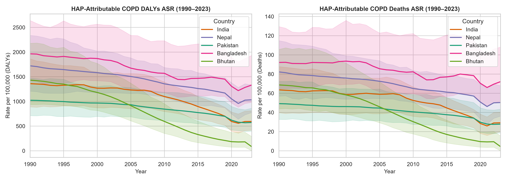
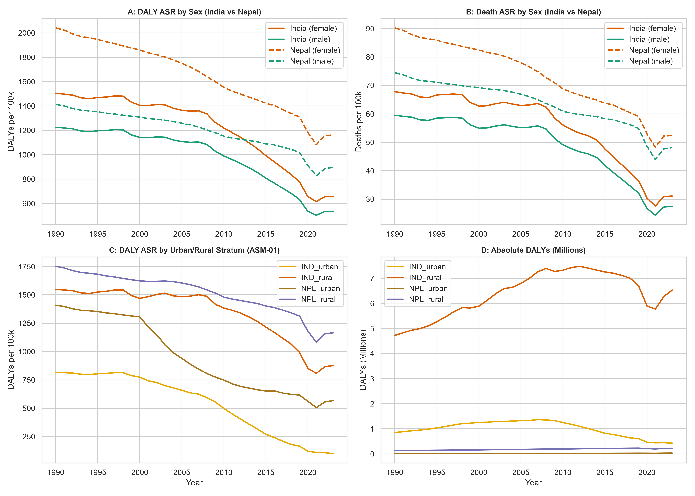
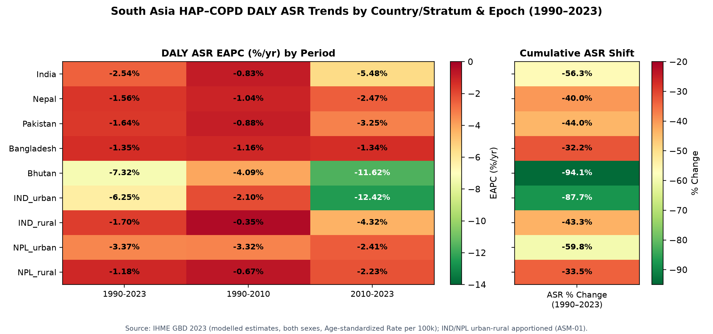

---

## 6. Stage 2: 2040 Burden Forecasting & Counterfactual Interpretation (`B-11` & `B-12`)

### 6.1 Rolling-Origin Cross-Validation, ETS Bug Fix & Multi-Horizon Skill (`B-12`)
Original Stage 2 CV across three 5-year rolling-origin test windows (`2009–2013`, `2014–2018`, `2019–2023`, `81` `origin × location × sex` series in `s2_rolling_cv_metrics.csv`) reported tied errors for `arima` and `ets` (`49.266` MAE, `57.019` RMSE, `2.905` MASE) because `ExponentialSmoothing.fit(disp=False)` threw a `TypeError` in `statsmodels 0.14`, triggering a silent fallback to `ARIMA(1,1,0)`. In **B-12**, we removed `disp=False`, eliminated silent fallbacks (logging all fit errors explicitly), and re-evaluated 9 models across **4 horizons** (`h = 1, 3, 5, 10`) on the non-redundant combined-sex `both` 9-location panel (`891` evaluations, `0` failures in `s2_cv_summary_b12.csv`):

| Model (`h = 5`, `both`-sex 9 locations) | Mean CV MAE | Mean CV RMSE | Mean MASE *(vs 1-yr)* | Pooled Rel. MAE *(vs h=5 Naive)* | Pooled Skill Score | Role & Technical Audit (`B-12`) |
| --- | ---: | ---: | ---: | ---: | ---: | --- |
| `ets_undamped` | **47.726** | **55.361** | **2.648** | **0.4615** | **+53.85%** | Best 5-yr & 10-yr statistical trend model after fixing `disp=False` |
| `ets_damped` | **48.785** | **56.874** | **2.751** | **0.4717** | **+52.83%** | Conservative damped statistical trend (`max |ETS - ARIMA| > 80/100k` per stratum) |
| `arima` | **49.334** | **57.066** | **2.869** | **0.4770** | **+52.30%** | `ARIMA(1,1,0)` — `h=1` winner (`11.31` MAE, **`0.67` MASE**, `+65.7%` skill) |
| `drift` | 63.744 | 71.068 | 3.545 | 0.6163 | +38.37% | Deterministic linear extrapolation benchmark |
| `theta` | 79.282 | 87.320 | 4.474 | 0.7666 | +23.34% | `ThetaModel(period=1)` statistical benchmark |
| `naive_baseline` | 103.425 | 113.344 | 5.600 | 1.0000 | 0.00% | Horizon-matched persistence benchmark (`y_origin`) |
| `log_ols_panel` | 140.960 | 145.597 | 6.189 | 1.3629 | −36.29% | Smooth covariate panel (`t + cf`); reaches positive `+8.78%` skill by `h = 10` |
| `poisson_rate_glm` | 147.553 | 150.719 | 6.144 | 1.4267 | −42.67% | Log-linear covariate GLM; reaches positive `+4.93%` skill by `h = 10` |
| `hist_gbdt_panel` | **172.232** *(114.25 all-sex)* | **178.638** | **8.143** | 1.6653 | −66.53% | **Legacy Stage 2 BAU export (retained);** replaced as Stage 3 counterfactual surrogate in B-13 (`DEC-029`, Section 6.2) |

**Four Critical Interpretations Established in B-11 / B-12 / B-13:**
1. **Why `MASE > 1.0` at `h = 5` While Skill Is Strongly Positive (`+52%` to `+54%`):** In `compute_mase`, numerator `mae` averages **5-year-ahead out-of-sample errors**, whereas denominator `scale = mean(|diff(y_train)|)` averages strictly in-sample **1-year first differences**. At **`h = 1`**, where numerator and denominator match, `arima` (`0.67`), `ets_damped` (`0.73`), and `ets_undamped` (`0.73`) all achieve **`MASE < 1.0`**. Against a **horizon-matched** 5-year naive persistence baseline (`103.42` MAE), fixed `ets_undamped` cuts error by **53.85%**.
2. **Historical Trend Accuracy vs. Clean-Fuel Counterfactual & Long-Run BAU Modelling:** `ARIMA`/`ETS` win short-term trend CV (`h = 1, 3, 5, 10`), yet lack `clean_fuel_share` covariates and extrapolate recent post-2021 trend inflections (`~9.0M` 2040 `ARIMA`/`ETS_damped` total DALYs vs. `2.70M` under ongoing clean-fuel expansion). Thus `forecasts_stage3_reconciled.csv` retains the `2.70M` reconciled BAU trajectory, while B-13 replaces `HistGBDT` in Contract 3 (`exposure_response_surrogate.json`) with **pooled `log_ols_smooth`** (`Section 6.2`), eliminating `HistGBDT`'s `151.00` counterfactual MAE, `124.08/100k` leaf collapse, and `0.0` `IND_urban` plateau.
3. **`IND_urban` Plateau Across Tree Models & Smooth Parametric Sensitivity (`B-12 Task 5`):** Both unconstrained `HistGBDT` and monotonic `HistGBDT` (`monotonic_cst=[0, -1, 0, 0]`) plateau identically (`slope = 0.0`) above `clean_fuel_share = 0.96` (`max_train(cf) = 0.958` in 2023 `IND_urban`). Smooth parametric `Log-OLS` eliminates the plateau (`IND_urban` slope `−2.1933`) and improves 4-unit CV MAE (`102.34` vs `151.00`), while applying `−2.1933` to `IND_urban` shifts Stage 3 GA DALY-Minimal by only **`−1.08%`** (`2.229M -> 2.205M`, `s3_b12_counterfactual_sensitivity.csv`) without changing rural-first priorities.
4. **Full-Precision Hierarchical Verification (`B-12 Task 1`):** Enforcing exact float64 additivity prior to CSV formatting (`s2_hierarchical_audit_b12.csv`) verifies `pop_F + pop_M == pop_both` (`0.0` error), `DALYs_F + DALYs_M == DALYs_both` (`1.86e-9`), population-weighted ASR consistency (`2.27e-13`), Stage 1 urban+rural additivity (`2.91e-11`), non-mixing of incompatible NPHC 2021/DEGURBA definitions, and absence of any comparable regional aggregate row, while demonstrating why Top-Down WHO GHE 2021 avoids Bottom-Up (`+50,254` DALYs) and OLS MinT (`+16,751` DALYs) total biases (`s2_reconciliation_methods_b12.csv`).

### 6.2 Reconciled 2040 BAU Forecasts & Smooth Log-OLS Exposure–Response Surrogate (`Contract 3`)
Following B-13 side-by-side comparison ([`src/forecast/b13_surrogate.py`](../src/forecast/b13_surrogate.py), [`B13_SURROGATE_COMPARISON_REPORT.md`](../B13_SURROGATE_COMPARISON_REPORT.md)), reconciled 2040 BAU counts and rates from `forecasts_stage3_reconciled.csv` remain unchanged (`2,699,837.26` DALYs), while Contract 3 (`exposure_response_surrogate.json`) replaces `HistGradientBoosting` (preserved in `exposure_response_surrogate_histgbdt.json`) with **pooled Smooth Log-OLS** (`log(ASR) ~ t + clean_fuel_share + C(location)`, `slope_clean_fuel = -2.1933 ± 0.2557 SE`, `R^2 = 0.8938`, `4-unit h=5 CV MAE = 102.34 vs. 151.00`):

| Unit | 2040 BAU Clean Fuel | Female DALYs (`Reconciled`) | Male DALYs (`Reconciled`) | Combined `both` DALYs (`[Lower, Upper]`) | Female ASR *(Proxy)* | Male ASR *(Proxy)* | Log-OLS Slope `β` *(vs HistGBDT)* |
| --- | ---: | ---: | ---: | ---: | ---: | ---: | ---: |
| `IND_urban` | `0.985` | `462,795.89` | `402,890.39` | `865,686.28` `[650,996, 1,080,376]` | `136.05` | `112.68` | **`−2.1933`** *(was `0.0000`)* |
| `IND_rural` | `0.850` | `863,550.39` | `751,770.21` | `1,615,320.60` `[1,214,721, 2,015,920]` | `191.51` | `158.62` | **`−2.1933`** *(was `−2.2794`)* |
| `NPL_urban` | `0.820` | `11,948.30` | `8,532.16` | `20,480.46` `[15,401, 25,560]` | `231.25` | `181.30` | **`−2.1933`** *(was `−2.8553`)* |
| `NPL_rural` | `0.480` | `115,717.34` | `82,632.58` | `198,349.92` `[149,159, 247,541]` | `959.83` | `752.53` | **`−2.1933`** *(was `−3.7254`)* |
| **Total (4 Units)** | — | **`1,454,011.92`** | **`1,245,825.34`** | **`2,699,837.26`** `[2,030,278, 3,369,397]` | `194.26*` | `162.85*` | `r_fm = 1.05`, `sd = 0.2557` |

*\*Population-weighted reconciled BAU ASR gap = **`31.41`/100k** (`IND_urban 23.37`, `IND_rural 32.90`, `NPL_urban 49.95`, `NPL_rural 207.31`).*

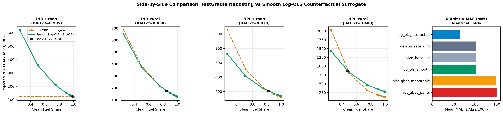
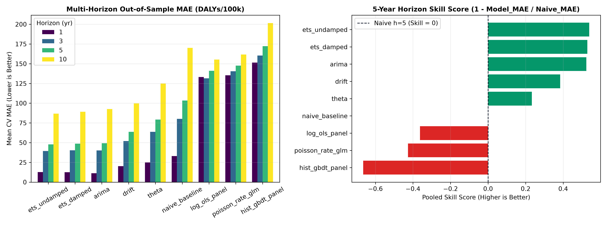

---

## 7. Intervention Parameters (`Contract 4`: `REAL_V1_2024USD`)

Active parameters in `configs/intervention_params.json` (`is_mock: false`) replace synthetic `MOCK_V1`:
- **Base Budget Cap (`50%` Fiscal Scenario):** **`\$5,985.73M`** (`50%` of the `\$11,971.47M` 2025 observed-household LPG gap); `25%` (`\$2,992.87M`), `100%` (`\$11,971.47M`), WHO-2024 (`\$2,991.24M`), and derived-2024 (`\$2,703.61M`) caps are evaluated in sensitivity.
- **Full `0 → 1.0` Unit Cost (`2024 USD Millions`, 50% public co-finance assumption for Biomass & Electric):** `IND_urban` LPG `\$11,963.51M` / Bio `\$2,798.79M` / Elec `\$3,303.20M`; `IND_rural` LPG `\$20,120.71M` (`\$90.30/HH`) / Bio `\$4,707.12M` (`\$22.50/HH`) / Elec `\$5,555.45M` (`\$26.555/HH`); `NPL_urban` LPG `\$552.11M` / Bio `\$103.65M` / Elec `\$146.66M`; `NPL_rural` LPG `\$292.11M` (`\$106.00/HH`) / Bio `\$48.74M` (`\$22.50/HH`) / Elec `\$68.97M` (`\$31.835/HH`).
- **Effectiveness (`η`):** `lpg_subsidy = 0.78`, `improved_biomass = 0.25`, `electric_induction = 0.85`.
- **Scenario A Infrastructure Constraint (`DEC-024`):** `infra_lpg_grid` remains `null` with `P1=P2=P3=0.0` caps, restricting adoption to initially ready technologies (`IND_urban`: LPG+Grid, `IND_rural`: LPG only, `NPL_urban`: LPG+Grid; `NPL_rural` unready for both and restricted to `improved_biomass`).

---

## 8. Stage 3: Multi-Objective `NSGA-II` Optimisation (Reconciled Scenario A, Log-OLS Surrogate)

Five seeded `NSGA-II` runs (`seeds 42–46`, pop `80`, `100` gens, `40,000` evaluations, `2.73s`) under `log_ols_smooth` (`slope = −2.1933 ± 0.2557 SE`) discover **`251` feasible non-dominated Pareto plans** (`s3_pareto_front.csv`, `s3_selected_plans.csv`, `s3_baseline_comparison.csv`; HistGBDT baseline `265` pts preserved in `outputs/tables/histgbdt_baseline_snapshot/`):

| Method / Plan | Solution ID | Deterministic Cost (`\$M`) | Deterministic 2040 DALYs | DALYs Averted (`vs. 2.70M BAU`) | Reconciled Equity Gap (`ASR/100k`) | Combined HV / Status |
| --- | ---: | ---: | ---: | ---: | ---: | --- |
| **BAU Baseline** (`zero action`) | — | `\$0.00M` | `2,699,837` | `0` (`0.0%`) | `31.41` | — |
| **Cost-Minimal** | `#0` | `\$70.75M` | `2,640,478` | `59,359` (`2.2%`) | `30.42` | Margin of front |
| **Knee Compromise** | `#156` | **`\$1,695.91M`** | **`2,388,130`** | **`311,707`** (`11.5%`) | **`26.85`** | Trade-off elbow |
| **DALY-Min (`= Equity-Min`)** | `#250` | **`\$3,097.29M`** | **`2,246,364`** | **`453,474`** (`16.8%`) | **`24.91`** | Extreme corner |
| `nsga2_combined_5seeds` | 251 pts | `\$70.75–\$3,097.29M` | Min `2,246,364` | Max `453,474` | Min `24.91` | **`2.7965e+10`** |
| `baseline_random_search` | 197 pts | `\$1,162–\$2,734M` | Min `2,294,847` | Max `404,990` | Min `25.58` | `2.2915e+10` *(beaten by NSGA-II)* |
| `baseline_proportional_split` | 1 pt | `\$2,068.07M` | `2,362,996` | `336,841` | `26.51` | `1.5999e+10` *(beaten by NSGA-II)* |
| `baseline_greedy_dalys_per_dollar` | 1 pt | `\$757.81M` | `2,485,832` | `214,005` | `28.21` | `1.2117e+10` *(beaten by NSGA-II)* |

Seed hypervolume stability across `42–46` is tight (`mean = 2.7717e+10`, `std = 1.4480e+08`). Replacing the `IND_urban` `0.0` plateau with `−2.1933` allows modest urban electric induction (`+0.015` in DALY-Min `#250`), while normalizing `NPL_rural` from `−3.7254` to `−2.1933` shifts DALY-Min averted DALYs conservatively from `469,179` (`\$3,076.02M`) to **`453,474`** (`\$3,097.29M`, `−3.3%`).

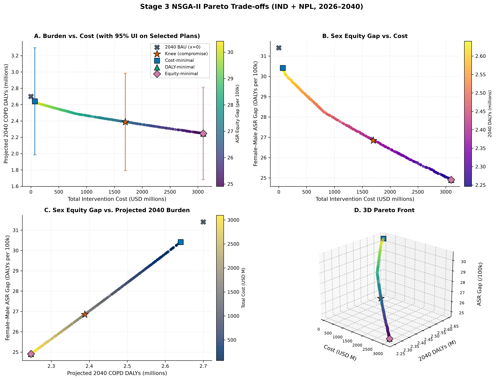
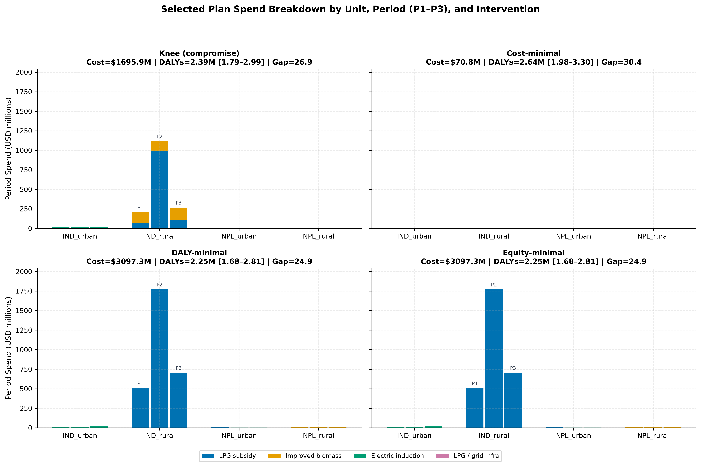
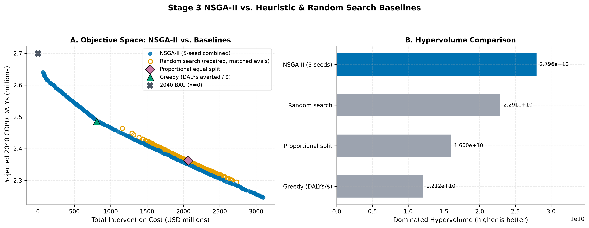

---

## 9. Stage 4: Sequential & Symbolic Planning (`MDP`, `HTN`, `PDDL`) & Fairness Audit (`B-11 Task 3` & `B-13`)

### 9.1 Parameter Calibration, HTN, and Scenario A PDDL Baseline
- **MDP (`src/planning/mdp.py`, `λ = 116.0`):** Evaluated over `22,136` reachable states in `2.72s` against the updated Log-OLS Pareto front (median Pareto slope `125.5 DALYs/\$1M`).
- **HTN (`src/planning/htn.py`, `plan_htn_trace.json`):** Deterministic **9-leaf** feasible schedule spending **\$807.36M**.
- **PDDL (`pddl/problem_ind_npl_existing_infra.pddl`, `pyperplan A*+hFF`):** Solves Scenario A in `7` steps (`\$3,262.52M`).

### 9.2 Stochastic Comparison Fairness & Violation Mechanics (`1,000` CRN Rollouts)
`src/planning/compare.py` (`comp_ga_vs_mdp.csv`, `4.72s`) evaluates all strategies over identical `1,000` CRN shock rollouts (`[0.5×, 1.0×, 1.25×]`):

| Strategy | Paradigm | Mean 2040 DALYs (`[p05–p95]`) | Mean DALYs Averted | Mean Cost (`\$M`) | Mean Eq Gap (`ASR`) | Mean Scalarized Return | Shock Violation Rate |
| --- | --- | ---: | ---: | ---: | ---: | ---: | ---: |
| **`mdp_adaptive_b6`** | MDP (adaptive) | `2,572,374` `[2.53M–2.62M]` | `127,463` | `\$600.35M` | `29.51` | `46,750` | **`0.0%`** |
| **`mdp_adaptive_b11`** | MDP (adaptive) | `2,572,374` `[2.53M–2.62M]` | `127,463` | `\$600.35M` | `29.51` | `46,750` | **`0.0%`** |
| `ga_matched_best (id=113)` | GA (open-loop) | `2,454,317` `[2.41M–2.51M]` | `245,520` | `\$1,176.87M` | `27.78` | **`90,698`** | `40.0%` |
| `ga_knee` | GA (open-loop) | `2,399,514` `[2.35M–2.47M]` | `300,323` | `\$1,695.91M` | `27.02` | `83,701` | `36.5%` |
| `ga_daly_minimal` | GA (open-loop) | `2,262,680` `[2.19M–2.36M]` | **`437,157`** | `\$3,097.29M` | **`25.14`** | `64,417` | `40.0%` |
| `ga_cost_minimal` | GA (open-loop) | `2,642,550` `[2.64M–2.65M]` | `57,288` | `\$70.75M` | `30.45` | `39,123` | `40.0%` |
| `pddl_classical_plan` | PDDL (open-loop) | `2,289,581` `[2.22M–2.41M]` | `410,256` | `\$3,262.52M` | `25.60` | `31,131` | `26.9%` |

Under the conservative Log-OLS rural slope (`−2.1933` vs. `−3.7254`), `λ = 116.0` makes discrete `lpg` bins slightly above marginal cost-effectiveness relative to `bio(+1)`, so `MDP` deploys lower-cost biomass-focused recourse (`127.5k` averted at `\$600.4M` vs. `203.7k` at `\$1,078.8M` under HistGBDT) while `λ = 100.0` steps up smoothly to `321.7k` averted at `\$2,402.8M` (`plan_mdp_sensitivity.csv`). **B-14 Clamping Fairness Audit (`comp_mdp_clamp_audit_b14.csv`):** Auditing pre-clamp vs. post-clamp transitions proves MDP's `0.0%` violation rate arises because `_apply_action_branch` clips `ceil(1.25 × steps)` overshoots at `(cap_bins, max_bin - raw_u)` before `Stage3Evaluator` sees realized `delta_bins`; MDP's pre-clamp attempted violation rate is **`40.0%`** (`400/1,000` rollouts, yielding `132,017` attempted vs. `127,463` realized averted DALYs). When open-loop GA schedules (`ga_matched_best`, `ga_knee`, `ga_daly_minimal`) undergo symmetric period-cap and ceiling execution clamping, their violation rates likewise drop from `36.5%–40.0%` to **`0.0%`** (`237,529`, `294,246`, and `426,024` averted DALYs), proving neither paradigm dominates on both raw compliance and expected burden reduction.

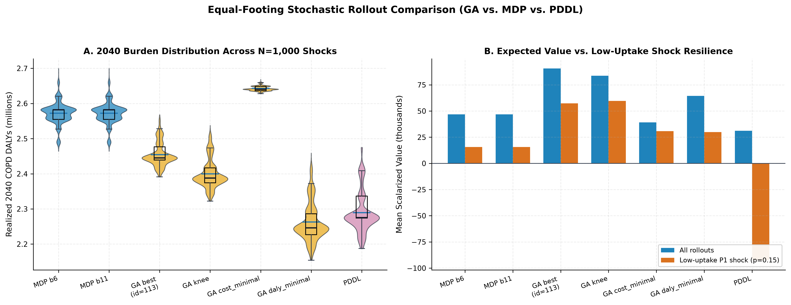
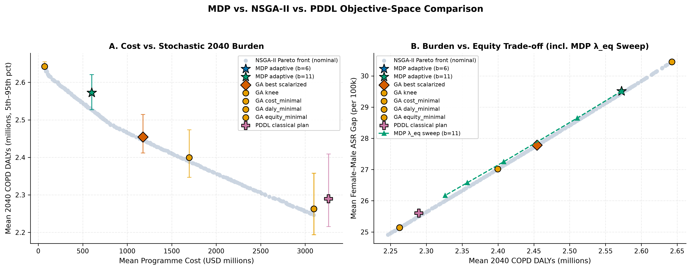
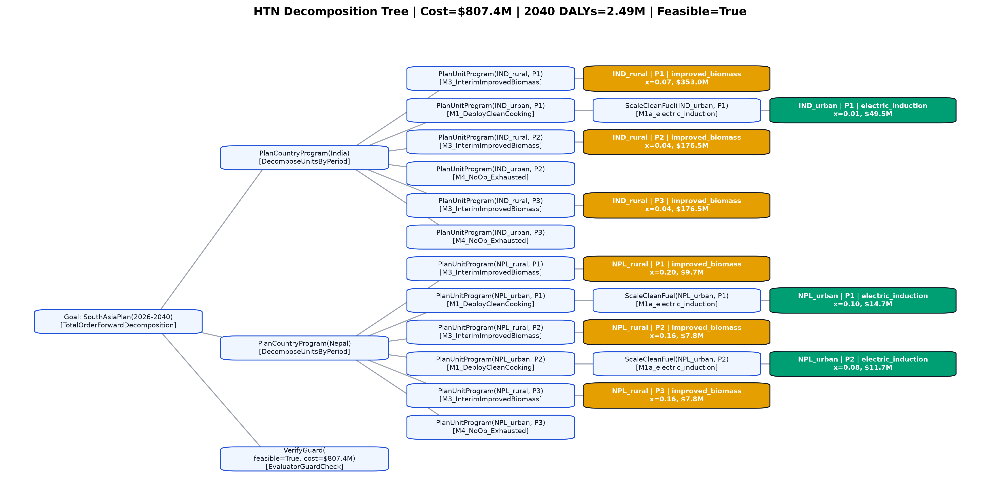

---

## 10. Joint 500-Draw Monte Carlo Uncertainty Re-Evaluation (`Reconciled` + `Log-OLS`)

Propagating `500` reconciled Stage 2 forecast draws (`stage2_uncertainty_draws_reconciled.csv`) jointly with analytical Log-OLS slope SE (`sd = 0.2557`, `s3_pareto_reeval.csv`):

| Strategy | Deterministic Cost (`\$M`) | Deterministic DALYs | 500-Draw Stage 2 Only (`Mean [p2.5–p97.5]`) | 500-Draw Joint Stage 2 + Surrogate (`Mean [p2.5–p97.5]`) | Analytical Eq Gap (`Joint MC Mean`) |
| --- | ---: | ---: | ---: | ---: | ---: |
| `bau_zero_action` | `\$0.00M` | `2,699,837` | `2,714,694` `[2.24M–3.17M]` | `2,714,694` `[2.24M–3.17M]` | `31.41` (`31.57`) |
| `ga_cost_minimal` | `\$70.75M` | `2,640,478` | `2,655,699` `[2.18M–3.11M]` | `2,655,775` `[2.18M–3.11M]` | `30.42` (`30.61`) |
| `ga_pareto_q1 (id=50)` | `\$453.95M` | `2,552,915` | `2,567,662` `[2.11M–3.01M]` | `2,567,229` `[2.10M–3.01M]` | `29.16` (`29.42`) |
| `ga_knee (id=156)` | `\$1,695.91M` | `2,388,130` | `2,402,403` `[1.99M–2.80M]` | `2,401,031` `[1.97M–2.80M]` | `26.85` (`27.26`) |
| `ga_daly_minimal` | `\$3,097.29M` | `2,246,364` | `2,260,218` `[1.87M–2.63M]` | `2,258,315` `[1.87M–2.63M]` | `24.91` (`25.44`) |

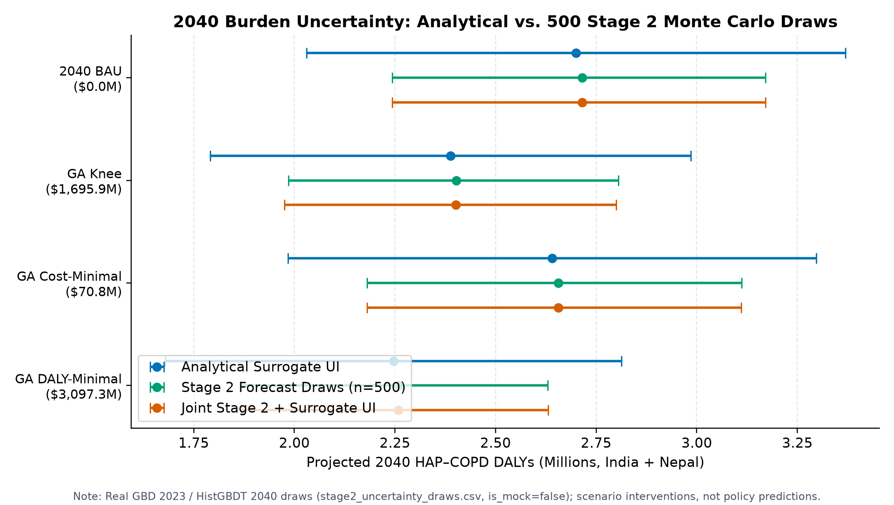

---

## 11. Comprehensive 8-Factor Sensitivity & Recurring Opex Suite (`18` Scenarios)

Across `18` full `NSGA-II + MDP` runs (`s3_sensitivity_real.csv`, `s3_recurring_opex_sensitivity.csv`):

| Factor Group | Scenario | DALY-Min Averted | DALY-Min Cost (`\$M`) | Knee Averted (`Cost`) | MDP Mean Averted | Key Finding |
| --- | --- | ---: | ---: | ---: | ---: | --- |
| **0. Base** | `base_50pct_scenario_a` (`\$5,985.7M`) | `453,474` | `\$3,097.29M` | `311,707` (`\$1,695.9M`) | `127,696` | Saturation below budget cap |
| **1. Budget** | `25%` (`\$2,992.9M`) / `WHO 50%` (`\$2,991.2M`) / `Derived 50%` (`\$2,703.6M`) | `443,484` / `443,153` / `414,704` | `\$2,992.31` / `\$2,988.96` / `\$2,703.23M` | `312,356` / `311,027` / `289,298` | `127,696` | `100%` matches Base identically; tighter caps bind DALY-min |
| **2. Bridge** | `bridge = 0.8` vs. `1.2` | `447,290` vs. `454,156` | `\$3,864.99M` vs. `\$2,583.46M` | `319,342` vs. `319,409` | `112,043` vs. `332,013` | Lower bridge raises cost `+\$768M`; higher lowers `−\$514M` |
| **3. `η_biomass`** | `0.15` → `0.30` → `0.32` → `0.50` | `437,586` → `492,076` | `\$3,096.3–\$3,141.3M` | `301,411` → `372,612` | `243,412` / `133,470` / `215,847` | Primary biological sensitivity lever (`NPL_rural`) |
| **4. Induction Cap** | `induction_caps_halved` | `453,184` | `\$3,103.41M` | `312,187` (`\$1,708.3M`) | `127,696` | Minor effect (`NPL_urban` headroom small) |
| **5. Discounting** | `ga_cost_discounted_0_774` / `mdp_gamma_1_0` | `456,184` / Base | `\$2,018.41M` / Base | `328,103` (`\$1,123.4M`) | `314,470` / Base | Discounting cuts nominal GA spend `−34.8%` |
| **6. HH Baseline** | `hh_baseline_derived_2024` | `453,474` | `\$3,097.29M` | `311,707` (`\$1,695.9M`) | `127,696` | Identical to Base (`2040 BAU` pop headroom tighter) |
| **7. Infra (`B1/B2`)** | `infra_scenario_b1_low` (`B2 high`) | **`513,035`** (`512,856`) | `\$3,196.66M` (`\$3,226.02M`) | `346,289` (`340,578`) | `194,941` | **`+59,562` additional DALYs:** P1 `NPL_rural` infra unlocks LPG/Elec |
| **8. Cost Boundary** | `societal_100pct_bio_elec` / **Alt B LPG opex** | `456,493` | `\$3,228.43M` | `318,367` (Alt B Knee: `\$2,531.4M`, DALY-min: `\$5,192.8M`) | `247,335` | Alt B recurring LPG opex raises Knee `+49.3%` & DALY-min `+67.7%` (`1.68×`, `< \$5,985.7M`) |

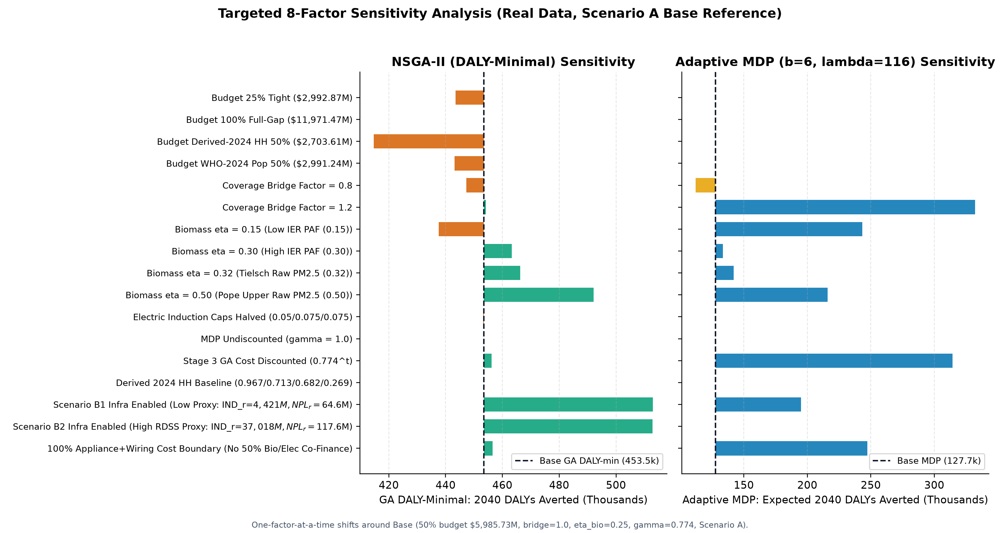

---

## 12. Interactive Offline Research Website & Reproducibility (`B-11`–`B-14`)

The offline static application (`site/`, launchable via `./site/start_site.sh` or `.venv/bin/python -m http.server 8000 --directory site`) serves all reconciled real-data JSON payloads (`site/data/*.json`), `20` publication figures (`site/assets/images/real/`), and `60` registered downloadable CSV/JSON/PDDL/MD/YAML/TXT/PNG links in `research.json` (`73` files total under `site/downloads/` including pre-existing `downloads/figures/` bundles) across 7 sections while keeping `MOCK_V1` fixtures cleanly labelled in `assumptions.js`. Full HTTP `200` verification across all `100` served site/asset/download URLs (`bad = []`) and schema checks succeeded; interactive Chromium visual verification could not execute automatically because `npx` (required by `chrome_devtools` MCP) is absent on this host.

For tests, `Makefile` separates fixture/contract tests (`make test` → `pytest -k "not test_stage1_pipeline_run"`: **69 passed, 3 interim-parquet skipped, 1 deselected**) from the external raw-archive test (`make test-raw` → `tests/historical/test_historical.py::test_stage1_pipeline_run`), preserving Person A's original test without deletion or unconditional skipping. Following restoration and SHA-256 verification of both single-age `UN WPP 2024` archives (`418,121,725` B and `440,981,531` B), `make test-raw` completes WPP ingestion (`170 country-years`) and stops deterministically on the missing World Bank JSON (`FileNotFoundError: data/raw/EG.CFT.ACCS.json`); acquisition provenance for all 11 raw files in `data/raw/manifest.json` (`2` restored, `3` World Bank API timed out, `6` interactive IHME GBD / WHO portal exports) is documented in [`docs/REPRODUCIBILITY.md`](../docs/REPRODUCIBILITY.md).

---

## 13. Limitations, Integrity Disclosures & Ethical Framing

1. **Modelled Epidemiological Estimates:** GBD 2023 values are modelled estimates rather than observed vital counts; aggregate age structure forced a reduced-form `poisson_rate_glm` instead of APC decomposition.
2. **Stage 2 CV Trade-Off, Fixed `ETS` & Smooth Log-OLS Replacement (`B-12`–`B-14`):** Original Stage 2 `ETS` fell back silently to `ARIMA` (`statsmodels` `disp=False` `TypeError`); B-12 removed `disp=False`, logged failures explicitly (`0` across `891` evaluations), and established `ets_undamped` (`47.73` MAE, `+53.9%` skill) ahead of `ets_damped` (`48.78`) and `arima` (`49.33`) at `h = 5` (`both` sex), with `MASE < 0.75` at `h = 1`. Following B-13 side-by-side comparison ([`B13_SURROGATE_COMPARISON_REPORT.md`](../B13_SURROGATE_COMPARISON_REPORT.md)), production Contract 3 replaces `HistGradientBoosting` (preserved at `exposure_response_surrogate_histgbdt.json`) with pooled **`log_ols_smooth`** (`slope = −2.1933 ± 0.2557 SE`, `h=5` 4-unit CV MAE `102.34` vs. `151.00`), eliminating leaf-collapse (`124.08/100k`) and `IND_urban = 0.0` saturation while leaving reconciled 2040 BAU (`2.70M`) untouched. Across 500 Monte Carlo draws (`s3_pareto_reeval.csv`), drawing 8 independent unit×sex surrogate perturbations widens `95%` intervals slightly less (`~0.8%–2.3%`) than a single shared pooled slope perturbation (`−2.1933 ± 0.2557`). See [`B12_FORECASTING_QA_REPORT.md`](../B12_FORECASTING_QA_REPORT.md) and [`B14_FINAL_AUDIT_REPORT.md`](../B14_FINAL_AUDIT_REPORT.md).
3. **Proxy Sex Disaggregation & Intervention Elasticity:** Reconciled sex counts/rates are WHO GHE 2021 proxy-derived allocations (`WHO_GHE_SEX_SPLITS`) constrained to combined `both` totals, paired with a uniform proxy responsiveness ratio `r_fm = 1.05`.
4. **Unverified Infrastructure Costs (`infra_lpg_grid`):** Disabled (`null`) in `Scenario A` and bracketed via explicit proxy assumptions in `Scenario B1/B2`.
5. **Non-Prescriptive Scenario Framing:** Cost envelopes and DALY projections explore trade-offs under explicit assumptions (`docs/ASSUMPTIONS.md`), not official government budgets or medical advice.

---

## 14. References

1. **IHME GBD 2023.** Institute for Health Metrics and Evaluation. https://vizhub.healthdata.org/gbd-results/
2. **UN DESA Population Division.** *World Population Prospects 2024.* https://population.un.org/wpp/
3. **WHO GHO SDG 7.1.2 Clean Cooking.** https://www.who.int/data/gho/data/indicators/indicator-details/GHO/proportion-of-population-with-primary-reliance-on-clean-fuels-and-technologies-for-cooking-(-)
4. **WHO Global Health Estimates (GHE) 2021.** https://www.who.int/data/gho/data/themes/mortality-and-global-health-estimates
5. **IIPS & ICF (2021); MoHP Nepal & ICF (2023).** *India NFHS-5 (2019–21)* & *Nepal NDHS 2022*. https://dhsprogram.com/
6. **MoPNG / PPAC / PRS India / NOC Nepal.** Targeted LPG subsidy benchmarks. https://ppac.gov.in/ ; https://prsindia.org ; https://pib.gov.in
7. **EESL NECP / AEPC Nepal / MNRE / World Bank ESMAP.** Clean-cooking stove hardware & wiring benchmarks. https://eeslmart.in ; https://aepc.gov.np ; https://mnre.gov.in ; https://worldbank.org
8. **Tielsch et al. (2016); Pope et al. (2017); WHO (2021).** https://doi.org/10.1016/S2214-109X(16)30024-9 ; https://doi.org/10.1016/j.envint.2017.01.012 ; https://doi.org/10.1016/j.envpol.2021.118198 ; https://www.who.int/publications/i/item/9789240034228
9. **Blank & Deb (2020) `pymoo`; Alkhazraji et al. (2020) `pyperplan`.**

---

## Appendix A: Curated Final Deliverables (`outputs/final_real_data/`)

All curated real tables (`s1_*`, `s2_*`, `s2_sex_reconciliation_audit.csv`, `s3_*`, `plan_*`, `comp_*`) and publication PNGs (`s1_*`, `s2_*`, `s3_*`, `plan_*`) are archived with `.meta.json` provenance sidecars in [`outputs/final_real_data/`](../outputs/final_real_data/manifest.json).
